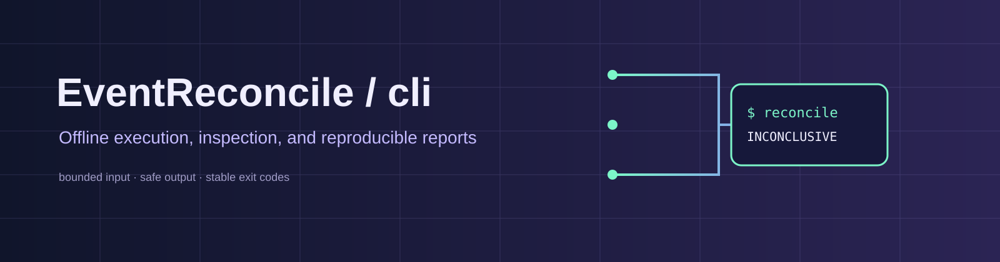
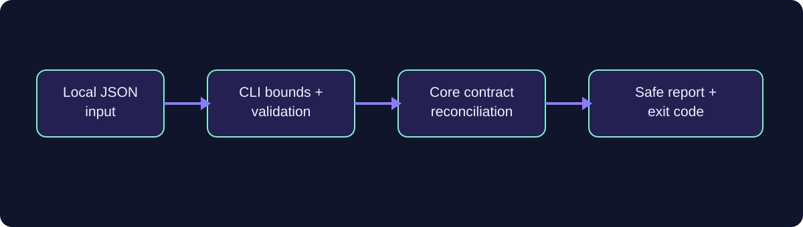

# EventReconcile-cli



[](https://github.com/EventReconcile/EventReconcile-cli/actions/workflows/ci.yml) [](LICENSE) [](https://go.dev/) [](docs/PROJECT_STATUS.md)

An offline-first Go command-line workflow for inspecting core-compatible event datasets and writing reproducible reconciliation reports.

## Repository role

The CLI owns command parsing, bounded local input/output, diagnostics, safe report destinations, machine-readable reports and exit-code contracts. It consumes `EventReconcile-core` and does not import source adapters or duplicate reconciliation algorithms.

## Architecture



Adapters produce core-compatible input as a separate step. The CLI preserves `PASS`, `FAIL` and `INCONCLUSIVE`; it does not upgrade unknown provenance or coverage into a success.

## Quickstart

Requirements: Go 1.25.x.

```powershell
go vet ./...
go test -count=1 ./...
go run ./cmd/eventreconcile --input input.json --output report.json
```

Exit codes: `0` PASS, `1` FAIL, `2` INCONCLUSIVE, `3` usage/input/output error. Reports use create-only semantics and existing files are never overwritten.

## Documentation and status

- [Project status](docs/PROJECT_STATUS.md)
- [Contributing](CONTRIBUTING.md)
- [Security](SECURITY.md)
- [Code of conduct](CODE_OF_CONDUCT.md)
- [Changelog](CHANGELOG.md)

## Related repositories

- [EventReconcile-core](https://github.com/EventReconcile/EventReconcile-core) — authoritative contracts and reconciliation engine.
- [EventReconcile-adapters](https://github.com/EventReconcile/EventReconcile-adapters) — real export normalization.

## License

Licensed under [Apache-2.0](LICENSE).
